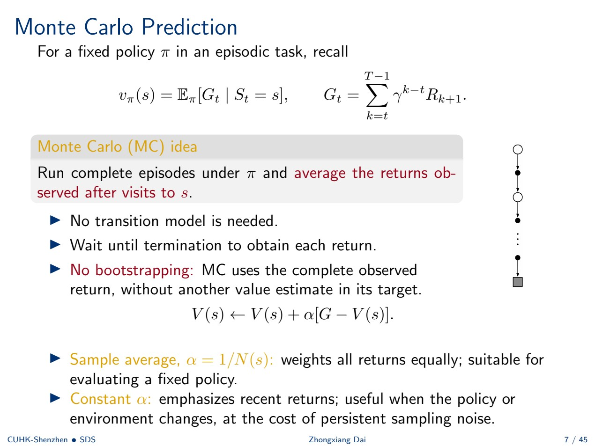
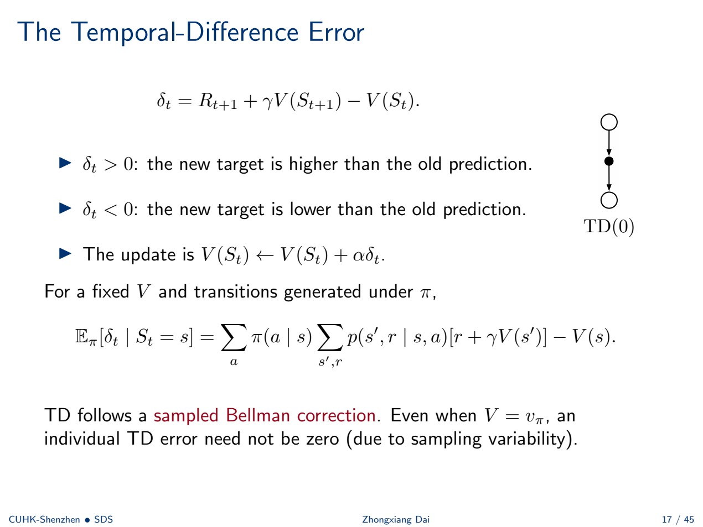
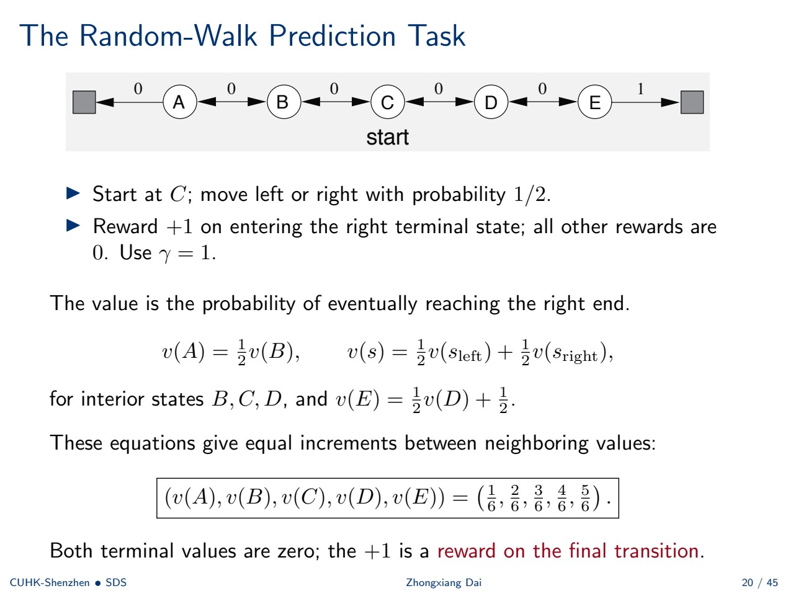
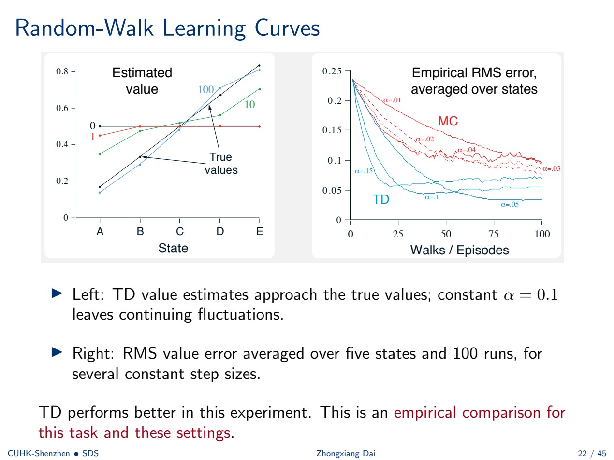
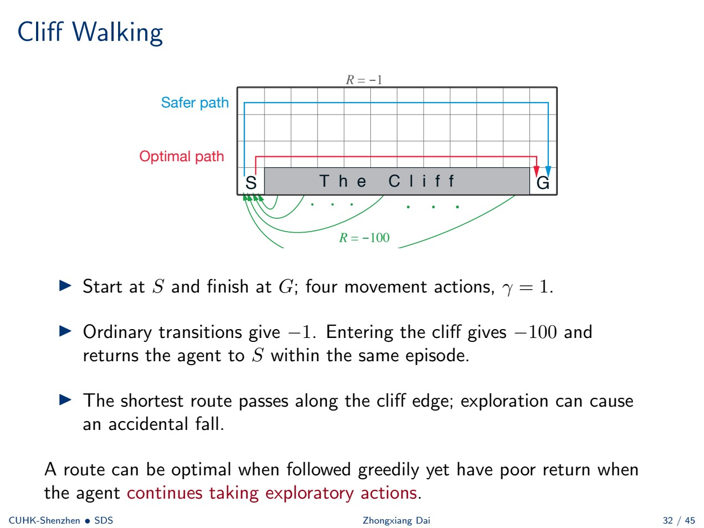
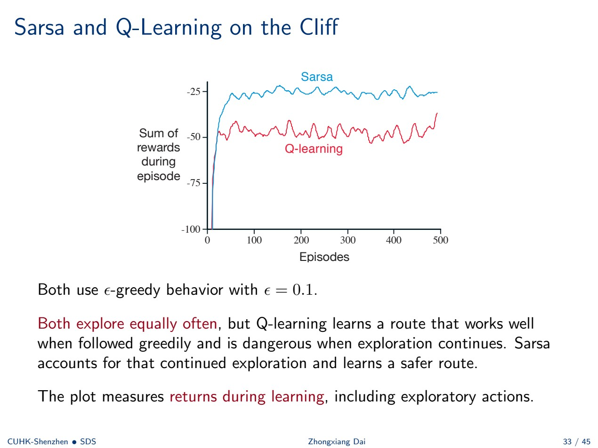
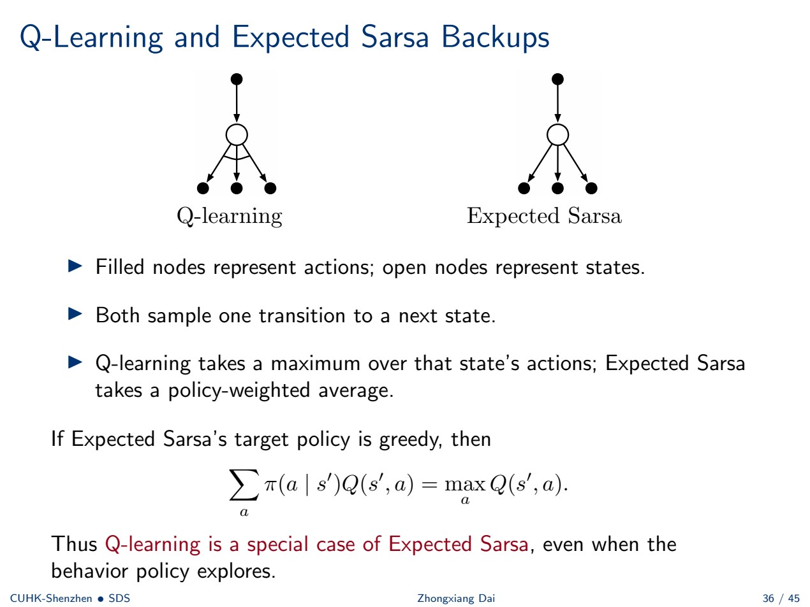
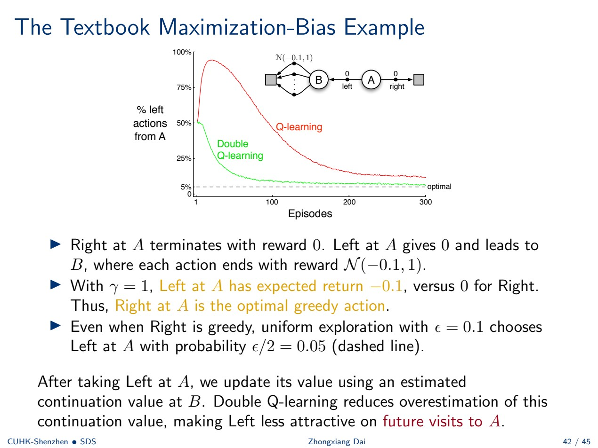

# 第 4–5 周：基于价值的学习方法

> 来源：`Week 4-5.pdf`，共 45 页。课件 P2 明确说明两周使用同一份课件，因此本篇合并整理。CSC6129，2026 秋季，Zhongxiang DAI。来源页码均指 PDF 实际页码。“原例”沿用课件设定；补充解释、验算与自测为学习辅助。

[返回学习入口](README.md) · [第 3 周](week03.md) · [第 6 周](week06.md) · [术语与符号](glossary.md) · [逐页对应表](coverage.md#week04-05)

## 本章怎样学

**核心问题：不知道环境转移概率，只能经历一次次状态、动作与奖励，怎样学出价值并改进决策？**

第 3 周用模型算期望；本章用经验替代期望计算。学习顺序是完整回报 MC → 一步预测 TD → 动作价值控制 Sarsa → 贪心目标 Q-learning → 期望目标 Expected Sarsa → 分开选择与评估的 Double Q-learning。

建议分两次学习：第一次读 §1–5，亲算 MC、重要性采样和随机游走；第二次读 §6–11，对比控制方法及其目标。这个分段是自学建议，课件没有划定第 4 周与第 5 周的页面边界。

先备知识：第 3 周的 $G_t$、$v_\pi$、$q_\pi$、贝尔曼方程，以及第 2 周的增量均值与 $\epsilon$-greedy。本章仍约定 $A_t$ 引起 $R_{t+1}$。

### 目录

- [1. 从模型计算到经验学习及课程安排](#w4-5-1)
- [2. Monte Carlo 预测](#w4-5-2)
- [3. Monte Carlo 控制与探索](#w4-5-3)
- [4. 同策略、异策略与重要性采样](#w4-5-4)
- [5. TD 预测与随机游走](#w4-5-5)
- [6. Sarsa 同策略控制](#w4-5-6)
- [7. Q-learning 异策略控制](#w4-5-7)
- [8. 原例：悬崖行走](#w4-5-8)
- [9. Expected Sarsa 与三种目标比较](#w4-5-9)
- [10. 最大化偏差与 Double Q-learning](#w4-5-10)
- [11. 方法总表与函数近似预告](#w4-5-11)
- [12. 复习与自测](#w4-5-12)

<a id="w4-5-1"></a>
## 1. 从模型计算到经验学习及课程安排

来源：P1–6。

### 1.1 数据来自交互

上一章已知模型，可以直接计算固定策略的一步期望目标：

$$
\sum_a\pi(a\mid s)\sum_{s',r}p(s',r\mid s,a)[r+\gamma V(s')].
$$

现在只给交互轨迹 $S_0,A_0,R_1,S_1,A_1,R_2,\ldots,S_T$，不直接给转移概率。经验可以来自真实环境，也可以来自生成样本的模拟器。

- **预测：** 给定策略，估计其 $v_\pi$ 或 $q_\pi$。
- **控制：** 利用学到的动作价值改进策略。

> **补充解释：** 可以从模拟器采样，不等于已经知道完整转移表。能够问“执行一次会发生什么”，与能够枚举所有结果及概率，是不同的信息条件。

### 1.2 课件更新的课程路线

P3 说明会保留核心 RL 基础，并给大语言模型强化学习更多时间：

| 周次 | 计划主题 |
| --- | --- |
| 6–8 | 价值函数近似、策略梯度、Actor–Critic、PPO |
| 9–13 | RLHF、DPO、可验证奖励与 GRPO、推理、使用工具的智能体 |
| 14 | 课程复习 |

这是本份课件给出的计划，具体进度可能随授课调整；它更新了第 1 周介绍中的课程节奏。

<a id="w4-5-2"></a>
## 2. Monte Carlo 预测

来源：P7–8。

### 2.1 用完整回报逼近期望

在回合制任务中，固定策略 $\pi$：

$$
v_\pi(s)=\mathbb E_\pi[G_t\mid S_t=s],\qquad
G_t=\sum_{k=t}^{T-1}\gamma^{k-t}R_{k+1}.
$$

Monte Carlo（MC，蒙特卡洛）反复执行完整回合，收集访问状态 $s$ 后的回报，再求平均。不需要转移模型，但必须等回合终止后才知道该回报。

$$
V(s)\leftarrow V(s)+\alpha[G-V(s)].
$$

- $\alpha=1/N(s)$：对迄今采用的回报等权平均，适合固定策略评估。
- 常数 $\alpha$：强调近期数据，有助于跟踪策略或环境变化，但采样波动不会随数据量自然消失。

**MC 不使用自举（bootstrapping）**：目标 $G$ 全由观察到的奖励组成，不依赖另一个状态的价值估计。课件备份图是一条采样路径一直延伸到终止；DP 则展开所有可能的一步后果。



### 2.2 首次访问与每次访问

同一个状态可能在一回合内多次出现。原例 $\gamma=1$：

$$
A\xrightarrow{1}B\xrightarrow{2}A\xrightarrow{3}\mathrm{terminal}.
$$

逐时刻回报为 $G_0=6,G_1=5,G_2=3$。

| 方法 | 对 A 使用的回报 | 仅根据这回合得到的估计 |
| --- | --- | ---: |
| 首次访问 MC | 6 | 6 |
| 每次访问 MC | 6、3 | $(6+3)/2=4.5$ |

首次访问指每回合沿**正向时间第一次**出现；每次访问则使用全部出现。同一回合的多个回报相互关联。首次访问便于以独立回合样本分析，每次访问利用更多访问；两者都估计 $v_\pi$，不存在任何任务上都更准确的一种。

> **补充解释：** “使用更多样本”不自动等于“拥有同样多的独立信息”。这里两个 A 的回报都包含最后一次奖励 3，因此它们并不独立。

<a id="w4-5-3"></a>
## 3. Monte Carlo 控制与探索

来源：P9–11。

### 3.1 为什么控制要学习 Q

$$
q_\pi(s,a)=\mathbb E_\pi[G_t\mid S_t=s,A_t=a].
$$

访问 $(s,a)$ 后，把相应完整回报用于估计 $Q(s,a)$。只有 $V$ 时，通常还需要模型才能判断某动作会去哪里；有了 $Q$，直接比较各动作即可。

经验版广义策略迭代为：执行策略采样回报 → 更新 $Q\approx q_\pi$ → 改进策略 → 继续采样。$q_\pi$ 包含第一步之后遵循 $\pi$ 的回报，后续策略改变会改变这个目标，因此评估要持续进行。

### 3.2 探索起点与回合内探索

纯贪心策略可能永远不试一个被低估的动作。课件给出两条思路：

1. **探索起点（exploring starts）：** 每个状态–动作对都有非零概率成为回合起点，但现实环境未必允许任意初始化。
2. **回合内探索：** 使用 $\epsilon$-greedy，让不是当前最优的动作也有机会被执行。

选定一个 $a^*(s)\in\arg\max_a Q(s,a)$，记动作数为 $m$，则：

$$
\pi(a\mid s)=\begin{cases}
1-\epsilon+\epsilon/m,&a=a^*(s),\\
\epsilon/m,&a\ne a^*(s).
\end{cases}
$$

$\epsilon$-soft 策略要求每个动作概率至少为 $\epsilon/m$，其中 $0<\epsilon\le1$；$\epsilon$-greedy 是其中一种。这里公式把利用概率给一个选定的最大动作；最大值并列时，也可以按约定在最大动作间分配利用概率。

### 3.3 同策略首次访问 MC 控制算法

初始化 $Q(s,a)$、计数 $N(s,a)=0$ 和一条 $\epsilon$-soft 策略。每回合：

```text
用当前 π 生成完整回合
G = 0
从 t = T-1 倒推到 0：
    G = R[t+1] + γ G
    如果 (S[t], A[t]) 没有在 0,...,t-1 出现：
        N(S[t], A[t]) += 1
        Q(S[t], A[t]) += (G - Q(S[t], A[t])) / N(S[t], A[t])
        将该状态的策略改为对 Q 的 ε-greedy
```

**倒序计算回报，正序判定首次访问。** 如果倒序遍历时简单地“第一次遇到就更新”，得到的会是正向最后一次访问，和课件算法不同。

> **补充解释：** 第 3 周精确策略改进建立在真实价值上；这里 $Q$ 来自有限样本，有噪声。一次策略更新可能降低真实价值，不能把每一步更新都解释为有保证的改进。

<a id="w4-5-4"></a>
## 4. 同策略、异策略与重要性采样

来源：P12–14。

### 4.1 两种策略角色

- **目标策略 $\pi$（target）：** 希望评估的策略，控制任务中也会改进它。
- **行为策略 $b$（behavior）：** 实际收集经验的策略。

两者相同是同策略（on-policy）；目标可以与行为不同是异策略（off-policy）。例如行为继续探索，而目标选择贪心动作。直接平均行为策略产生的回报，通常得到 $v_b$，而非 $v_\pi$。

需要覆盖条件：$\pi(a\mid s)>0$ 的动作必须满足 $b(a\mid s)>0$，否则目标可能走的轨迹没有机会出现在数据中。

### 4.2 推导轨迹重要性比率

对从 $t$ 到终止的轨迹后缀 $\tau_t=(A_t,R_{t+1},S_{t+1},\ldots,S_T)$，给定起点：

$$
P_\pi(\tau_t\mid S_t)=\prod_{k=t}^{T-1}\pi(A_k\mid S_k)p(S_{k+1},R_{k+1}\mid S_k,A_k).
$$

两条策略在相同环境中执行，因此求概率之比时环境项消去：

$$
\rho_{t:T-1}=\frac{P_\pi(\tau_t\mid S_t)}{P_b(\tau_t\mid S_t)}
=\prod_{k=t}^{T-1}\frac{\pi(A_k\mid S_k)}{b(A_k\mid S_k)}.
$$

然后转换期望：

$$
\begin{aligned}
\mathbb E_b[\rho_{t:T-1}G_t\mid S_t=s]
&=\sum_{\tau_t}P_b(\tau_t\mid s)\frac{P_\pi(\tau_t\mid s)}{P_b(\tau_t\mid s)}G_t(\tau_t)\\
&=\sum_{\tau_t}P_\pi(\tau_t\mid s)G_t(\tau_t)=v_\pi(s).
\end{aligned}
$$

只对 $b$ 下可能出现的轨迹求和，分母才非零；覆盖条件保证目标策略的轨迹没有被遗漏。

### 4.3 普通重要性采样及高方差原例

对 $n$ 个首次访问回报及相应轨迹权重：

$$
V(s)=\frac1n\sum_{i=1}^n\rho_iG^{(i)}.
$$

在标准的固定策略采样假设和覆盖条件下，这是无偏估计，但方差可能很高。

**原例：** $\pi$ 总向左，$b$ 每次以 $1/2$ 概率向左；如果剩余动作是连续三次 Left，则：

$$
\rho=\left(\frac1{1/2}\right)^3=8.
$$

只有这一回合且 $G=1$ 时，普通重要性采样给出 $V(s)=8$。如果动作序列含任何一次非 Left，权重为零。

> **补充解释：为什么估计会超过单次回报上界？** 无偏约束的是许多重复采样的平均，不是每次估计都落在真实价值的取值范围内。三次都向左的概率为 $1/8$，它出现时权重为 8，其余动作序列权重为零。长乘积容易把少数轨迹的噪声放大。课件此处使用普通重要性采样，不是把权重归一化后求均值的另一种估计。

<a id="w4-5-5"></a>
## 5. TD 预测与随机游走

来源：P15–22。

### 5.1 从回报递推得到 TD(0)

由 $G_t=R_{t+1}+\gamma G_{t+1}$，MC 需要等待完整未来回报；时序差分 TD(0) 用当前对后继状态的预测替代未来回报：

$$
Y_t=R_{t+1}+\gamma V(S_{t+1}),\qquad
V(S_t)\leftarrow V(S_t)+\alpha[Y_t-V(S_t)].
$$

奖励与后继状态来自一次真实采样，剩余未来由已存在的价值估计概括。这就是自举。TD(0) 是一步 TD 预测。

### 5.2 TD 误差是一次采样的贝尔曼修正

$$
\delta_t=R_{t+1}+\gamma V(S_{t+1})-V(S_t),\qquad
V(S_t)\leftarrow V(S_t)+\alpha\delta_t.
$$

$\delta_t>0$ 提高预测，$\delta_t<0$ 降低预测。固定一张 $V$ 表且转移由 $\pi$ 产生时：

$$
\mathbb E_\pi[\delta_t\mid S_t=s]
=\sum_a\pi(a\mid s)\sum_{s',r}p(s',r\mid s,a)[r+\gamma V(s')]-V(s).
$$

即使 $V=v_\pi$，单个 TD 误差也未必为零；在真实价值处，条件期望为零，采样波动仍然存在。



### 5.3 表格 TD(0) 算法

输入固定策略、步长与折扣；初始化非终止状态价值，保持 $V(\mathrm{terminal})=0$。每回合：

```text
初始化 S
只要 S 未终止：
    按 π 选择动作 A，观察 R 和 S′
    V(S) += α [R + γ V(S′) - V(S)]
    S = S′
```

每次转移后立即学习，不需要保存完整轨迹，也不需要等回合结束。

### 5.4 DP、MC、TD 的差别

| 方法 | 更新目标 | 需要转移模型 | 自举 | 何时可更新 |
| --- | --- | --- | --- | --- |
| DP | $\mathbb E_\pi[R_{t+1}+\gamma V(S_{t+1})\mid S_t]$ | 是 | 是 | 模型已知时计算 |
| MC | $G_t$ | 否 | 否 | 等完整回报获得后 |
| TD(0) | $R_{t+1}+\gamma V(S_{t+1})$ | 否 | 是 | 一次转移后 |

MC 包含整段未来轨迹的随机性；TD 目标还受到后继价值预测误差影响。TD 往往能有效利用经验，但不能据此断言任何任务上都比 MC 学得快。

### 5.5 原例：五状态随机游走

非终止状态从左到右为 A、B、C、D、E，两侧是终止状态。每回合从 C 开始，每步以相同概率向左或向右一格。进入右终点奖励 $+1$，其他奖励为零；$\gamma=1$。

两个终止状态价值都为零，$+1$ 是**进入右终点的转移奖励**。非终止状态价值等于最终从右边终止的概率。

$$
v(A)=\tfrac12v(B),\quad
v(s)=\tfrac12v(s_{\mathrm{left}})+\tfrac12v(s_{\mathrm{right}})\ (s=B,C,D),
$$

$$
v(E)=\tfrac12v(D)+\tfrac12,
\qquad(v(A),v(B),v(C),v(D),v(E))=(1/6,2/6,3/6,4/6,5/6).
$$



> **补充推导：** 把每个非终止状态的值写成左右邻居均值，就得到相邻数值差相等。左边界相当于右端命中概率 0，右边界命中概率 1，分成六段，每段差 $1/6$。这里的边界命中概率不是终止后的未来奖励价值；使用转移奖励写贝尔曼方程时，两个终止状态的价值仍设为零。

### 5.6 原例：同一条轨迹，MC 与 TD 更新不同

初值 $V(A)=\cdots=V(E)=0.5$，$\alpha=0.1,\gamma=1$。观察到：

$$
C\xrightarrow0B\xrightarrow0A\xrightarrow0\mathrm{terminal}.
$$

| 被更新状态 | 在线 TD(0) | 回合结束后常步长 MC |
| --- | --- | --- |
| C | $0.5+0.1(0+0.5-0.5)=0.5$ | $0.5+0.1(0-0.5)=0.45$ |
| B | $0.5+0.1(0+0.5-0.5)=0.5$ | $0.45$ |
| A | $0.5+0.1(0+0-0.5)=0.45$ | $0.45$ |

MC 在回合结束后把最终结果传给所有访问状态；在线 TD 当时更新 C/B 时，还不知道后面 A 会到终点。不能事后把 A 的新值倒灌进已经做完的在线更新。

### 5.7 原实验：学习曲线怎样读



左图横轴为 A–E，纵轴为估计价值，显示 TD 在 0、1、10、100 个回合后的估计及真值。常步长 $\alpha=0.1$ 下，估计仍会持续波动。

右图横轴为回合数（0–100），纵轴为五个状态上的均方根误差 RMS，再对 100 次运行平均。图中展示多个常步长：TD 为 $0.05,0.10,0.15$，MC 为 $0.01,0.02,0.03,0.04$。本实验中 TD 表现更好；结论限于此任务和这些设置。

> **补充解释：** 看“曲线越低越好”之前，要先确认纵轴是误差还是奖励。本图是误差；后面的悬崖图是回合奖励，两者的方向不同。

<a id="w4-5-6"></a>
## 6. Sarsa 同策略控制

来源：P23–27。

### 6.1 把 TD 从状态推广到状态–动作

固定策略的动作价值满足：

$$
q_\pi(s,a)=\mathbb E_\pi[R_{t+1}+\gamma q_\pi(S_{t+1},A_{t+1})\mid S_t=s,A_t=a].
$$

用一次转移与下一个实际选出的动作替代期望，用估计 $Q$ 替代真值：

$$
Y_t=R_{t+1}+\gamma Q(S_{t+1},A_{t+1}),\quad A_{t+1}\sim\pi,
$$

$$
Q(S_t,A_t)\leftarrow Q(S_t,A_t)+\alpha[Y_t-Q(S_t,A_t)].
$$

名字 Sarsa 来自五元组 **S、A、R、S、A**：$S_t,A_t,R_{t+1},S_{t+1},A_{t+1}$。

### 6.2 控制算法与动作传递

```text
初始化 Q；使用对 Q 的 ε-greedy 策略
每回合初始化 S，并据此选择 A
重复：
    执行 A，观察 R、S′
    若 S′ 终止：Y = R
    否则按当前策略选 A′：Y = R + γ Q(S′, A′)
    Q(S, A) += α [Y - Q(S, A)]
    若终止：结束回合
    S = S′；A = A′
```

**$A'$ 必须接着被执行。** 它既用于本次目标，又是下一步实际动作；如果更新之后随意再抽一次，得到的就不再是这份算法规定的数据流。探索动作也进入目标，所以 Sarsa 评估的是包含探索的自身行为。

### 6.3 预测与控制的关系

固定策略下，TD(0) 估计 $v_\pi$，Sarsa 估计 $q_\pi$；它们分别从状态和状态–动作出发做一步同策略评估。Sarsa **控制**还要把策略维持为对新 $Q$ 的 $\epsilon$-greedy，交替执行评估与改进。TD(0) 预测本身没有策略改进步骤。

### 6.4 Sarsa 收敛需要什么

对有限折扣 MDP、奖励有界，标准表格 Sarsa 到达最优价值的一条路线要求：

- 相关状态–动作对被无限多次访问。
- 策略在极限变成贪心，即非贪心动作概率趋零。
- 对每个状态–动作对自己的更新次数 $n$，步长满足：

$$
\sum_n\alpha_n(s,a)=\infty,\qquad
\sum_n\alpha_n(s,a)^2<\infty.
$$

逐渐减小 $\epsilon$ 是常见思路，但还必须保持充分探索。固定 $\epsilon>0$ 时，探索一直属于 Sarsa 的目标策略，不能直接套用“趋于完全贪心策略”的结论。

> **补充解释：** 第一个步长条件防止过早停止学习，第二个限制累积噪声。例如按每个表项自身更新次数取 $1/n$ 满足这两个和式。控制中策略依赖带噪声的 $Q$，每次更新仍没有单调提升真实策略价值的保证。

<a id="w4-5-7"></a>
## 7. Q-learning 异策略控制

来源：P28–31、P37。

### 7.1 从贝尔曼最优方程得到采样更新

由第 3 周的方程：

$$
q_*(s,a)=\sum_{s',r}p(s',r\mid s,a)\left[r+\gamma\max_{a'}q_*(s',a')\right],
$$

把环境结果的期望替换为一次观察，把 $q_*$ 替换为 $Q$：

$$
Y_t=R_{t+1}+\gamma\max_a Q(S_{t+1},a),
$$

$$
Q(S_t,A_t)\leftarrow Q(S_t,A_t)+\alpha[Y_t-Q(S_t,A_t)].
$$

环境的奖励与后继状态仍来自采样；下一动作则在当前表中取最大值。目标假设下一步贪心，即使真正的行为继续探索。

### 7.2 为什么是异策略，为什么这里不用重要性权重

行为策略 $b$ 可以是 $\epsilon$-greedy；目标策略则为 $\pi(s')\in\arg\max_aQ(s',a)$。下一步真实执行的动作可以和最大动作不同。

这份**一步 Q-learning** 更新无需重要性采样，原因是：

1. 已经给定本次执行的 $(s,a)$ 后，奖励和后继状态分布由环境决定，不依赖是哪个策略选中了 $a$。
2. 目标直接计算下一状态的最大动作值，没有使用从 $b$ 抽样的下一动作，因此没有需要重加权的下一动作样本。

行为仍决定哪些表项有机会被学习，覆盖不能省略。

> **补充解释：** MC 使用行为策略走完的整条未来轨迹，因此要校正后续动作概率；一步 Q-learning 只使用一条环境转移，再自行构造贪心延续目标。不能把这里“不用重要性采样”的理由推广到任意异策略多步更新。

### 7.3 课件算法

```text
初始化 Q 和探索性行为策略
每回合初始化 S
重复：
    由行为策略选 A，执行后观察 R、S′
    若 S′ 终止：Y = R
    否则：Y = R + γ max_a Q(S′, a)
    Q(S, A) += α [Y - Q(S, A)]
    若终止：结束回合
    S = S′
```

构造目标不需要先选下一行为动作；下一轮再按行为策略选择即可。

### 7.4 与 Sarsa 不同的收敛要求

有限折扣 MDP、奖励有界时，表格 Q-learning 在每个状态–动作对被无限多次更新，且各表项步长满足 §6.4 的两个和式条件时收敛到 $q_*$。

**Q-learning 的行为不必在极限变成贪心**，因为目标已经是贪心延续。持续探索可以提供覆盖，同时仍会降低智能体实际行动时的奖励。学到最优策略的价值，与行为中一直执行最优策略，是不同的事情。

这些是表格法的保证；第 6 周改用共享参数时需要另行分析。

<a id="w4-5-8"></a>
## 8. 原例：悬崖行走

来源：P32–33。

### 8.1 环境和风险

从 S 出发到 G，动作是上下左右，$\gamma=1$。普通转移奖励 $-1$；进入悬崖奖励 $-100$，并立即回到 S，**回合继续**，直到到达 G 才结束。



最短路沿悬崖上方走，完全贪心执行时很好；持续探索时，意外向下的一步会掉下悬崖。安全路线更长，但留出了缓冲距离。

### 8.2 原实验比较的是学习期间的回报



两者都使用 $\epsilon=0.1$ 的 $\epsilon$-greedy 行为。横轴是回合数（图中到 500），纵轴是每回合奖励总和，越高、越不负越好。

- Q-learning 目标假设下一步贪心，因而学到贴近悬崖的路线价值；真正执行时仍会探索，可能摔落。
- Sarsa 目标包含下一步实际探索动作的后果，因此倾向于绕远但更安全的路线。

两者的探索分支概率相同；差异不是 Sarsa “更少探索”，而是对未来继续探索的代价是否计入目标。图中 Sarsa 学习期间回报较好，并不推翻 Q-learning 对最优贪心延续价值的学习目标。

> **补充解释：** 评价算法前先明确是在持续探索下统计在线奖励，还是训练后关闭探索再评价。课件这里统计前者。不要把掉下悬崖写成终止事件，否则会改变训练数据与回报。

<a id="w4-5-9"></a>
## 9. Expected Sarsa 与三种目标比较

来源：P34–36。

### 9.1 对下一动作求期望

Sarsa 目标中的下一动作 $A_{t+1}\sim\pi(\cdot\mid S_{t+1})$ 是随机的。给定本次奖励、后继状态及当前价值估计，对这个动作平均：

$$
\mathbb E_\pi[Y_t^{\mathrm{Sarsa}}\mid R_{t+1},S_{t+1}]
=R_{t+1}+\gamma\sum_a\pi(a\mid S_{t+1})Q(S_{t+1},a).
$$

Expected Sarsa 用此期望作目标，再执行常规的 $Q\leftarrow Q+\alpha(Y-Q)$ 更新。它移除了**抽取下一动作**带来的随机性，奖励与后继状态的随机性仍存在。

求和只需动作概率和 $Q$，不需要环境转移模型。行为和目标策略相同可同策略使用，也可以评估另一目标策略。

### 9.2 原例：同一条转移，三种更新

设 $R=2,\gamma=0.9,\alpha=0.1$，旧 $Q(S,A)=4$；下一状态 Left、Right 的值为 5、1。$\epsilon=0.2$，所以选择概率分别为 $0.9,0.1$。假设下一个实际动作是 Right。

| 方法 | 目标 $Y$ | 新值 $4+0.1(Y-4)$ |
| --- | --- | ---: |
| Sarsa | $2+0.9(1)=2.9$ | 3.89 |
| Expected Sarsa | $2+0.9[0.9(5)+0.1(1)]=6.14$ | 4.214 |
| Q-learning | $2+0.9(5)=6.5$ | 4.25 |

同样观察到一个后继状态，Sarsa 使用采到的动作、Expected Sarsa 平均目标策略动作、Q-learning 使用最大动作。

### 9.3 Q-learning 是贪心目标下的特例

若 Expected Sarsa 的目标策略只在最大动作上分配概率，则：

$$
\sum_a\pi(a\mid s')Q(s',a)=\max_aQ(s',a).
$$

这时目标等于 Q-learning，即使行为策略继续探索也成立。若多个动作并列最大，在这些动作间怎么分配概率都得到相同的最大值。



实心节点表示动作，空心节点表示状态。两者都只采样一条环境转移，区别在于后继状态的动作分支是取最大值还是按策略加权。

<a id="w4-5-10"></a>
## 10. 最大化偏差与 Double Q-learning

来源：P38–42。

### 10.1 无偏估计的最大值可能有正偏差

两个动作真实价值都为零，各自的估计独立地以相同概率取 $+1$ 或 $-1$：

| $Q(s,a_1)$ | $Q(s,a_2)$ | 最大估计 |
| ---: | ---: | ---: |
| -1 | -1 | -1 |
| -1 | +1 | +1 |
| +1 | -1 | +1 |
| +1 | +1 | +1 |

$$
\mathbb E[\max_a Q(s,a)]=\frac{-1+1+1+1}{4}=\frac12
>0=\max_a\mathbb E[Q(s,a)].
$$

每个估计本身平均为零，但取最大值更容易选中估计误差恰好偏高的动作。这叫最大化偏差（maximization bias）。

### 10.2 把选动作和估价值分开

普通 Q-learning 用同一张表选动作并评价它：

$$
Y=R+\gamma Q\left(s',\arg\max_a Q(s',a)\right).
$$

Double Q-learning 使用两张表。更新 $Q_1$ 时：

$$
a^*\in\arg\max_a Q_1(s',a),\qquad Y=R+\gamma Q_2(s',a^*).
$$

$Q_1$ 的正误差可以帮助动作被选中，但 $Q_2$ 不一定共享相同正误差，从而减少重复使用“让它赢的那份高估”。

**它不保证每次目标都更小或无偏。** 两表可能相关，选择也可能选错；课件结论是减少系统性高估。

### 10.3 Double Q-learning 算法

初始化 $Q_1,Q_2$，行为按 $Q_1+Q_2$ 做 $\epsilon$-greedy。每观察到一条转移：

```text
以各 1/2 的概率选一张表更新
若选 Q1：
    非终止时 a* = argmax_a Q1(S′, a)
    Y = R + γ Q2(S′, a*)；终止时 Y = R
    Q1(S, A) += α [Y - Q1(S, A)]
若选 Q2：交换上述 Q1、Q2 的角色
继续到 S′；终止后重新开始回合
```

**用正在更新的表选动作，用另一张表评价；每次只改一张表。** 行为选择时对两张表求和，不等于目标也直接用两表最大值求和。

### 10.4 原例：错误偏好向左的两状态 MDP



每回合从 A 出发：Right 立刻终止，奖励 0；Left 奖励 0 并转到 B。在 B 有多个可选动作，各动作均立即终止，奖励服从 $\mathcal N(-0.1,1)$，第二个参数为方差。$\gamma=1$。

因此 A 的 Left 真实期望回报为 $-0.1$，Right 为 $0$，贪心最优动作是 Right。但 B 的多个带噪声估计取最大值后可能显得过于乐观，进而让 A 的 Left 被高估。

图中横轴为回合数（到 300），纵轴为从 A 选 Left 的百分比。$\epsilon=0.1$ 的均匀探索下，即使 Right 已是贪心动作，也会以 $\epsilon/2=5\%$ 的概率选 Left，虚线即这个基准。初始估计为零，平局随机打破，曲线对 10,000 次运行平均。

Double Q-learning 减少对 B 延续价值的高估，使 Left 在未来访问 A 时不那么有吸引力。左动作比例降到接近 5% 才与这套持续探索设定相符，不能要求必定降为零。

<a id="w4-5-11"></a>
## 11. 方法总表与函数近似预告

来源：P43–45。

### 11.1 所有方法都向一个目标移动

| 方法 | 非终止转移的目标 | 主要区别 |
| --- | --- | --- |
| MC | $G_t$ | 采样直到回合结束，无自举 |
| TD(0) | $R_{t+1}+\gamma V(S_{t+1})$ | 一步状态价值预测 |
| Sarsa | $R_{t+1}+\gamma Q(S_{t+1},A_{t+1})$ | 使用实际选择的下一动作 |
| Q-learning | $R_{t+1}+\gamma\max_aQ(S_{t+1},a)$ | 贪心延续目标 |
| Expected Sarsa | $R_{t+1}+\gamma\sum_a\pi(a\mid S_{t+1})Q(S_{t+1},a)$ | 对目标策略动作求平均 |
| Double Q-learning（更新第一张表） | $R_{t+1}+\gamma Q_2(S_{t+1},\arg\max_aQ_1(S_{t+1},a))$ | 分开动作选择与评价 |

终止转移的各一步 TD 目标均为 $R_{t+1}$。比较方法时问三个问题：采样多远、评估哪条策略、怎样使用后继价值？

### 11.2 五条主线

1. MC 平均完整回报；控制中探索保证有机会获得有用的动作数据。
2. TD 使用一步奖励与后继预测，不必等待最终结果。
3. Sarsa 把实际下一动作，包括探索，纳入评估与改进。
4. Q-learning 和 Expected Sarsa 分别采用贪心与策略加权的延续目标，要区分目标与行为。
5. Double 学习分开选择与评价，减少最大化偏差。

贝尔曼方程组织目标，交互经验提供数据。

### 11.3 第 6 周衔接

本章为每个状态或状态–动作对单独存值；第 6 周改用共享参数 $\hat v(s,\mathbf w),\hat q(s,a,\mathbf w)$，让一个状态的经验也影响相关状态。MC 回报与 TD 目标仍可作为信号，梯度负责把预测误差变成参数更新。

<a id="w4-5-12"></a>
## 12. 复习与自测

本节为补充学习材料。先独立重算，再展开答案。

### 12.1 易错点

| 容易混淆 | 正确理解 |
| --- | --- |
| MC 首次访问 | 指正向最早出现，不是倒序循环第一次遇到 |
| MC 普通重要性采样 | 除以回报条数 $n$，不是除以权重和 |
| TD 误差不为零 | 单次采样有噪声，不能直接推断真值错了 |
| 终止状态价值 | 设为零，终止那步的奖励仍计入 |
| Sarsa 的 $A'$ | 用于目标，随后实际执行 |
| Expected Sarsa 需要期望 | 只平均下一动作，不要求环境模型 |
| 探索与行为回报 | 持续探索可能损害在线回报，即使目标在学最优价值 |
| Double Q-learning | 选择与评价分工，每次只更新一张表 |
| 收敛结论 | 有条件的表格结论，不能自动推广到神经网络 |

### 12.2 自测与答案

**1. 在 $A\xrightarrow1B\xrightarrow2A\xrightarrow3\mathrm{terminal}$、$\gamma=1$ 中，两种 MC 对 A 分别用哪些回报？**

<details><summary>查看答案</summary>

首次访问只用 6；每次访问用 6 和 3，单回合平均为 4.5。B 的回报为 5。

</details>

**2. 为什么 MC 控制需要反复评估，而不能第一次学出 Q 后只改策略？**

<details><summary>查看答案</summary>

$q_\pi(s,a)$ 包括第一步后遵循旧策略的未来回报。改变后续策略会改变被评估的价值，因此需要继续收集新策略数据、更新 Q。

</details>

**3. 目标总向左，行为每次以 1/2 概率向左。连续三个 Left 的重要性权重是多少？中间出现 Right 呢？**

<details><summary>查看答案</summary>

连续三个 Left 的权重是 8；出现 Right 时目标动作概率为零，整个乘积为零。一个很大的单次估计与无偏性并不矛盾，无偏是重复采样的平均性质。

</details>

**4. 五状态游走真值已经学对，TD 误差是否每次都为零？**

<details><summary>查看答案</summary>

不是。例如在 C 的真值为 1/2 时，向 B 转移得到误差 $1/3-1/2=-1/6$，向 D 转移得到 $2/3-1/2=1/6$；条件平均为零。

</details>

**5. 从 C 经 B、A 到左终点，初值均为 0.5，常步长 0.1。在线 TD 一回合后 C 的值为什么仍是 0.5？**

<details><summary>查看答案</summary>

更新 C 时观察到奖励 0、B 的预测仍为 0.5，误差为零；A 后来降到 0.45 不会自动修改已经完成的 C 更新。MC 在终止后知道完整回报为零，所以也会把 C 更新到 0.45。

</details>

**6. Sarsa 构造目标用了一个探索动作 A'，更新后应不应该再抽下一动作？**

<details><summary>查看答案</summary>

课件算法把原先选出的 A' 传递到下一步执行。重新抽取可能与目标使用的动作不同，破坏该算法的数据流。

</details>

**7. 为什么一步 Q-learning 可以异策略学习而不乘轨迹重要性权重？**

<details><summary>查看答案</summary>

给定当前状态和动作，环境结果分布不依赖行为策略；下一动作目标直接取 Q 的最大值，没有从行为采样的下一动作需要校正。但行为必须访问需要学习的表项。

</details>

**8. 悬崖行走中两者均 ε=0.1，为什么 Sarsa 仍可能在线回报更好？**

<details><summary>查看答案</summary>

Sarsa 在目标中计入继续探索的风险，学到更安全的路线；Q-learning 估计的是贪心延续的价值，而实际行为仍可能探索并掉下悬崖。这里比较的是包含探索的学习期奖励。

</details>

**9. 使用 §9.2 的数据，算三种目标和更新后 Q。**

<details><summary>查看答案</summary>

Sarsa 为目标 2.9、新值 3.89；Expected Sarsa 为目标 6.14、新值 4.214；Q-learning 为目标 6.5、新值 4.25。差别来自下一动作如何处理。

</details>

**10. 两个均值为零、各取 ±1 的独立估计，最大值期望为什么不是零？**

<details><summary>查看答案</summary>

四种等概率组合中，只有两个都为 -1 时最大值为 -1，其余三种均为 +1，所以期望为 1/2。取最大值倾向挑中正误差。

</details>

**11. 补充算例：下一状态 Q1=(6,4)，Q2=(2,5)，R=1、γ=0.9；更新 Q1 时 Double Q 的目标是多少？**

<details><summary>查看答案</summary>

Q1 选择第一个动作，Q2 对同一动作的评价为 2，因此目标为 $1+0.9\times2=2.8$。不能先在 Q2 上重新取最大值 5。本题为补充，不是课件原例。

</details>

**12. Q-learning 的行为一直探索，是否必然不能学到 q*？**

<details><summary>查看答案</summary>

不必然。有限折扣、奖励有界、无限更新覆盖及合适步长等表格条件下，目标已经采用贪心延续，可学到 q*；但实际行动回报仍受探索影响。Sarsa 的标准最优收敛路线还要求策略在极限贪心。

</details>

### 12.3 掌握标准与来源

能够不看公式表写出六类目标，重算三种控制更新，解释同策略与异策略、探索与收敛、MC 与 TD 的差别，并读懂两张实验曲线。

本篇依据用户提供的第 4–5 周课件；其中 MC、TD、悬崖行走与 Double Q 图示引用 Sutton 与 Barto 教材对应内容。课件没有单独的参考文献页，可通过[逐页对应表](coverage.md#week04-05)核对具体原页。

[返回入口](README.md) · [继续第 6 周](week06.md)
