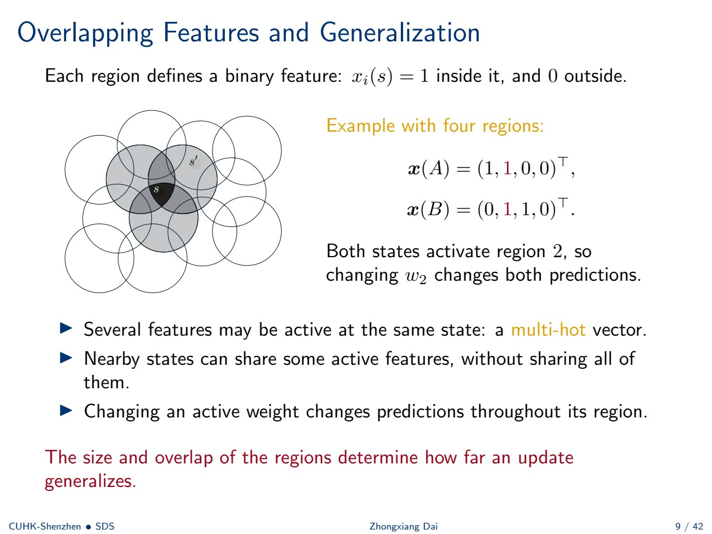
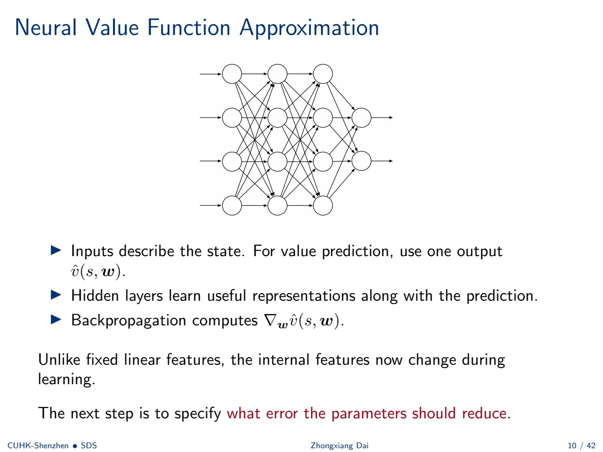
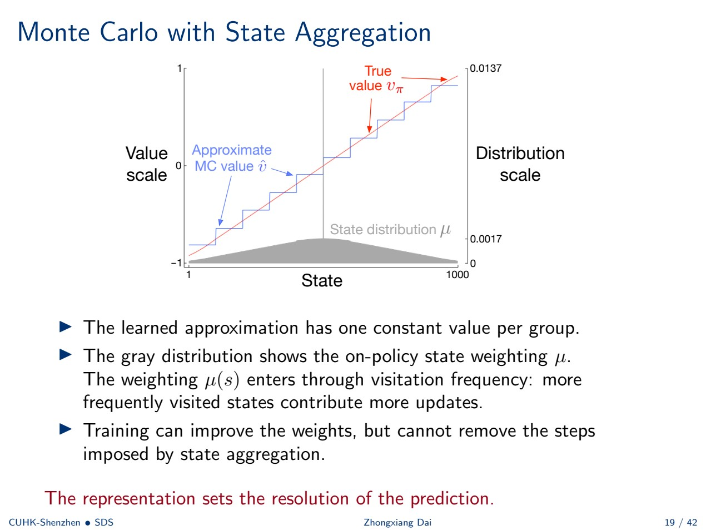
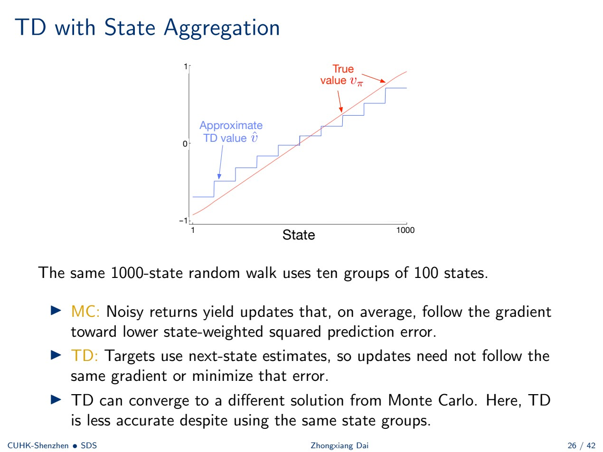
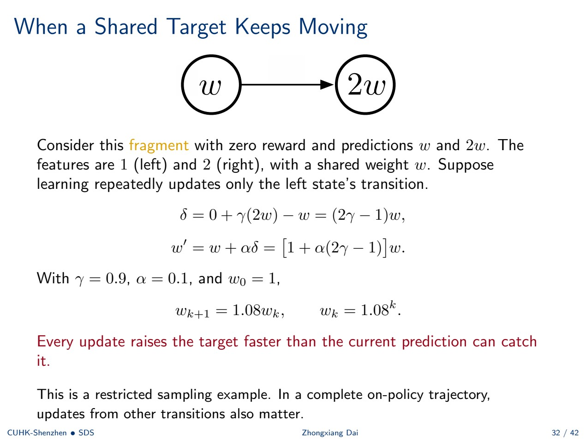
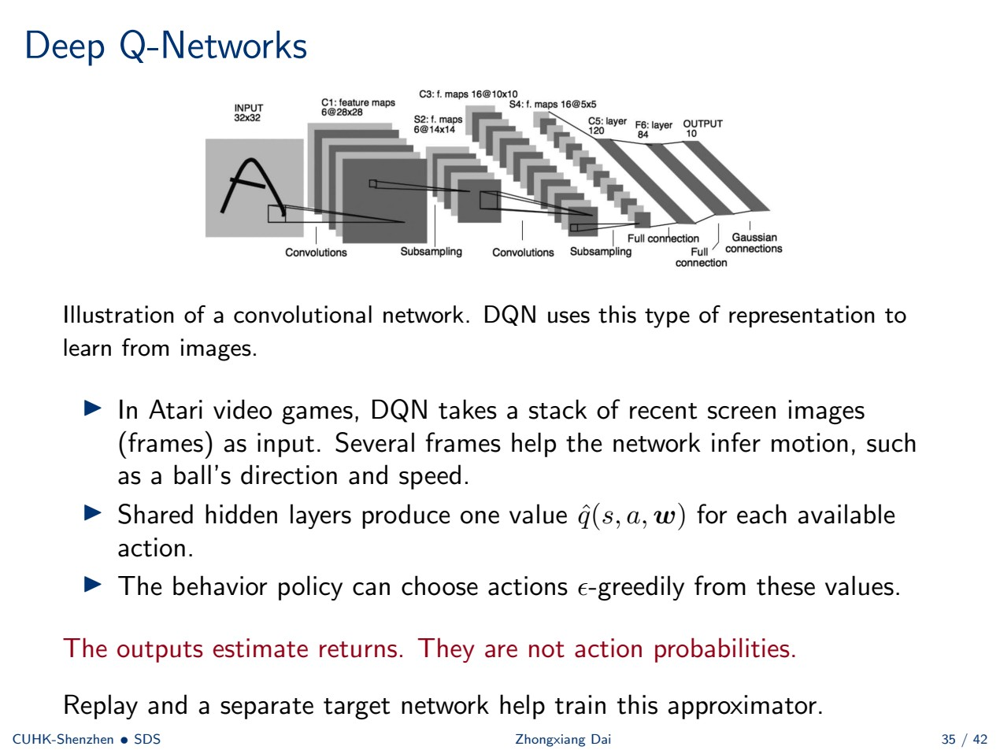

# 第 6 周：价值函数近似与 DQN

> 来源：`Week 6.pdf`，共 42 页。CSC6129，2026 秋季，Zhongxiang DAI。来源页码均指 PDF 实际页码。“原例”沿用课件设定；补充推导、解释与自测为学习辅助。

[返回学习入口](README.md) · [第 4–5 周](week04-05.md) · [术语与符号](glossary.md) · [逐页对应表](coverage.md#week06)

## 本章怎样学

**核心问题：状态太多或连续，无法为每个状态单独存值时，怎样用少量共享参数学习价值？这些共享又为何可能让学习不稳定？**

先读 §1–3，理解表示、泛化与误差目标；再读 §4–6，比较完整回报驱动的梯度 MC 和自举驱动的半梯度 TD；最后读 §7–10，把动作价值写成函数，解释不稳定原例与 DQN 的训练设计。不要只记网络名称，要能沿着一次转移写出目标、误差、梯度和更新。

先备知识：第 4–5 周 MC、TD、Sarsa、Q-learning；向量点积、平方误差和链式求导。不熟悉梯度时，先用课件的一个参数 $w$ 算例，再推广到参数向量 $\mathbf w$。

### 目录

- [1. 为什么要做函数近似](#w6-1)
- [2. 特征、状态聚合与神经网络](#w6-2)
- [3. 价值预测的误差目标](#w6-3)
- [4. 梯度 Monte Carlo](#w6-4)
- [5. 原例：1000 状态随机游走](#w6-5)
- [6. 半梯度 TD 预测](#w6-6)
- [7. 动作价值近似与半梯度控制](#w6-7)
- [8. 移动目标与致命三角](#w6-8)
- [9. DQN 的表示、回放与目标网络](#w6-9)
- [10. DQN 数值例与学习循环](#w6-10)
- [11. 方法比较与策略优化预告](#w6-11)
- [12. 复习与自测](#w6-12)

<a id="w6-1"></a>
## 1. 为什么要做函数近似

来源：P1–5。

表格法存储每个状态的 $V(s)$ 或每个状态–动作对的 $Q(s,a)$。连续状态空间有无限多状态，大型离散空间中许多状态也可能永远没有被访问。希望相近或相关状态可以共享经验，而不必逐一从头学习。

用带共享参数的函数表示：

$$
\hat v(s,\mathbf w)\approx v_\pi(s),\qquad \mathbf w\in\mathbb R^d.
$$

| 量 | 意义 | 改变条件 |
| --- | --- | --- |
| $v_\pi(s)$ | 固定策略下真实期望回报 | 环境、策略或回报定义改变 |
| $\hat v(s,\mathbf w)$ | 当前预测 | 参数或输入状态改变 |
| $\mathbf w$ | 需要从经验学习的参数 | 学习更新 |

**预测任务中策略保持固定。** 改变一个共享参数可能同时改变很多状态的预测；所选函数族决定哪些价值函数能够被表示。

> **补充解释：** 泛化指在某状态上学习也改变其他状态的预测。它是共享参数的主要好处，但也可能把某状态的误差传给其他状态，效果取决于表示是否合适。

<a id="w6-2"></a>
## 2. 特征、状态聚合与神经网络

来源：P6–10。

### 2.1 线性价值函数

用 $d$ 维特征向量 $\mathbf x(s)=[x_1(s),\ldots,x_d(s)]^\top$ 描述状态：

$$
\hat v(s,\mathbf w)=\mathbf w^\top\mathbf x(s)=\sum_{i=1}^dw_ix_i(s).
$$

特征描述位置、速度等状态属性，权重决定它们如何影响价值。常数特征 $x_1(s)=1$ 可以学习偏置。

**原例：** 对标量位置 $z$，使用 $\mathbf x(s)=(1,z,z^2)^\top$，得到 $\hat v=w_1+w_2z+w_3z^2$。它对位置是非线性的，对**参数**是线性的，仍属于线性函数近似。

### 2.2 表格是 one-hot 特征的特例

若共有 $m$ 个状态，为状态 $s_i$ 定义唯一激活的特征：

$$
x_i(s)=\mathbf1\{s=s_i\},\qquad \hat v(s_i,\mathbf w)=w_i.
$$

此时权重向量就是价值表。一次更新只修改所访问状态的参数；改用共享特征后，多个状态可以共同依赖同一个参数。

### 2.3 状态聚合

将状态划分成不重叠的组，每组一个权重：

$$
x_i(s)=\mathbf1\{s\text{ 属于组 }i\},\qquad
\hat v(s,\mathbf w)=w_{\mathrm{group}(s)}.
$$

| 状态 | 共享预测 | 一次更新影响 |
| --- | --- | --- |
| 1–100 | $w_1$ | 整组 100 个状态 |
| 101–200 | $w_2$ | 整组 100 个状态 |
| … | … | … |
| 901–1000 | $w_{10}$ | 整组 100 个状态 |

只用十个参数表示 1000 个状态。组越大，经验共享越多，但不能表示组内价值差异；即使无限训练也无法突破这个函数族的限制。

### 2.4 重叠特征与粗编码

每个区域一个二值特征，状态在区域内为 1，外部为 0。多个区域可以同时包含一个状态，因此向量可以是 multi-hot，而非只激活一个位置。

**原例：** 四个区域下，$\mathbf x(A)=(1,1,0,0)^\top$，$\mathbf x(B)=(0,1,1,0)^\top$。二者共享第二个特征，改变 $w_2$ 会同时改变它们的预测。区域大小、形状和重叠程度决定泛化传播多远。



> **补充推导：共享如何量化？** 线性更新若为 $\Delta\mathbf w=\alpha e\mathbf x(s)$，另一状态 $s'$ 的预测变化为 $\Delta\hat v(s')=\alpha e\mathbf x(s')^\top\mathbf x(s)$。二值特征下，内积就是两状态共享的激活特征个数。这个式子说明，一次更新可能影响多个未刚刚访问的状态。

### 2.5 神经网络近似

状态描述作为输入，隐藏层学习内部表示，价值预测使用一个输出 $\hat v(s,\mathbf w)$。反向传播计算 $\nabla_{\mathbf w}\hat v(s,\mathbf w)$。

与固定线性特征不同，内部特征也随着学习改变。课件示意图有多个输出来展示通用前馈网络；本节状态价值预测只需要一个输出。



表示选好后，还必须定义参数应该降低哪一种误差。

<a id="w6-3"></a>
## 3. 价值预测的误差目标

来源：P11–15。

### 3.1 状态加权的均方价值误差

固定策略 $\pi$，定义：

$$
\mathrm{VE}(\mathbf w)=\sum_{s\in\mathcal S}\mu(s)[v_\pi(s)-\hat v(s,\mathbf w)]^2,
\qquad\mu(s)\ge0,\quad\sum_s\mu(s)=1.
$$

$\mu$ 表示不同状态的重要程度。同策略预测中，它通常反映策略访问各状态的频率。表示能力有限时，误差目标优先顾及权重更大的状态；平均误差小仍可能掩盖低权重状态的大误差。

### 3.2 原例：两个状态共享一个值

只能用 $\hat v(A,w)=\hat v(B,w)=w$；真实值为 $v_\pi(A)=0,v_\pi(B)=2$。权重分别为 $3/4,1/4$：

$$
\mathrm{VE}(w)=\frac34w^2+\frac14(2-w)^2,
$$

$$
\frac{d\mathrm{VE}}{dw}=\frac32w-\frac12(2-w)=2w-1.
$$

最优折中为 $w=1/2$。如果两状态权重相同则为 1；现在 A 更重要，因此解更靠近 A 的真值 0。表示无法同时表达两个真值，所以学习必须折中。

### 3.3 从平方误差推导梯度更新

先假设真实目标 $v_\pi(S_t)$ 可用。单状态损失：

$$
\ell_t(\mathbf w)=\tfrac12[v_\pi(S_t)-\hat v(S_t,\mathbf w)]^2.
$$

链式法则给出：

$$
\nabla_{\mathbf w}\ell_t=-[v_\pi(S_t)-\hat v(S_t,\mathbf w)]\nabla_{\mathbf w}\hat v(S_t,\mathbf w).
$$

沿负梯度移动：

$$
\mathbf w_{t+1}=\mathbf w_t+\alpha[v_\pi(S_t)-\hat v(S_t,\mathbf w_t)]\nabla_{\mathbf w}\hat v(S_t,\mathbf w_t).
$$

误差决定需要抬高还是压低预测；梯度告诉我们每个参数如何影响预测，将修正分配到参数上。损失前的 $1/2$ 消去了平方求导的系数 2。

### 3.4 用采样目标替代未知真值

真值通常未知，换成目标 $U_t$：

$$
\mathbf w_{t+1}=\mathbf w_t+\alpha[U_t-\hat v(S_t,\mathbf w_t)]\nabla_{\mathbf w}\hat v(S_t,\mathbf w_t).
$$

如果本次更新中把 $U_t$ 当固定数，这正是 $\tfrac12[U_t-\hat v(S_t,\mathbf w)]^2$ 的负梯度方向。在适当采样条件下，真值的无偏目标可在期望中给出所需梯度方向。

第一种选择是完整回报 $U_t=G_t$；如果目标本身含当前预测，则需额外小心，这会导向半梯度。

<a id="w6-4"></a>
## 4. 梯度 Monte Carlo

来源：P16–17。

### 4.1 回报仍然完全来自经验

固定策略的回合完成后计算：

$$
G_t=R_{t+1}+\gamma R_{t+2}+\cdots+\gamma^{T-t-1}R_T.
$$

梯度 MC 的更新：

$$
\mathbf w\leftarrow\mathbf w+\alpha[G_t-\hat v(S_t,\mathbf w)]\nabla_{\mathbf w}\hat v(S_t,\mathbf w).
$$

线性近似的梯度就是特征，得到：

$$
\mathbf w\leftarrow\mathbf w+\alpha[G_t-\mathbf w^\top\mathbf x(S_t)]\mathbf x(S_t).
$$

每个激活特征对应的权重都会被更新。one-hot 特征时只改一个表项，退化为熟悉的表格 MC。

> **补充流程：** 固定策略采集完整回合 → 从后往前计算回报 → 对采用的访问，用其 $G_t$ 和当前预测计算误差 → 沿预测梯度更新参数。虽然参数可能在处理回合样本时改变，回报仍只是奖励之和，不含自举预测。

### 4.2 原例：在 A 学习，也改变 B

只有一个参数，$x(A)=1,x(B)=2$，$\hat v(s,w)=wx(s)$。初始 $w=1$，$\alpha=0.1$，访问 A 后得到回报 $G=3$：

$$
\hat v(A,1)=1,\quad e=3-1=2,\quad \frac{\partial\hat v(A,w)}{\partial w}=1,
$$

$$
w'=1+0.1(2)(1)=1.2.
$$

更新后 $\hat v(A,1.2)=1.2$，$\hat v(B,1.2)=2.4$。目标是在 A 观察到的，但 B 的预测也变了。

> **补充解释：** 不能把“误差乘步长”直接当成所有预测的变化量。参数改变量是 $0.2$，B 的特征为 2，所以 B 的预测改变量是 $0.4$。

<a id="w6-5"></a>
## 5. 原例：1000 状态随机游走

来源：P18–19，TD 对照见 P26。

### 5.1 环境与表示

非终止状态编号 1–1000，每回合从 500 开始。先等概率选 Left 或 Right，再均匀抽取 1–100 的移动距离。越过左边界终止得 $-1$，越过右边界终止得 $+1$；其他奖励为零，$\gamma=1$。

每相邻 100 个状态一组，共十组。组内真实价值可以不同，但预测必须相同。

**与上一章五状态游走区分：** 此处左终止奖励为 $-1$，上一章为 0；这里步长随机且可达 100，而非每次只走一格。不能照搬上一章的 $1/6,\ldots,5/6$ 真值。

### 5.2 MC 聚合结果与访问频率



横轴为状态编号，价值曲线使用左轴；灰色区域为状态分布 $\mu$，使用右轴。真值曲线与组内常数近似放在同图比较。

学习得到阶梯形函数：每组一个常数，组间发生跳变。访问频率使 $\mu$ 进入学习过程，访问多的状态提供更多更新，因此组内拟合偏向这些状态的真值。训练可以改善十个权重，却不能移除由状态聚合强加的台阶。

> **补充推导：一个组应该学到什么折中？** 若组内都预测 $w_i$，最小化组内加权误差可得 $w_i^*=\sum_{s\in i}\mu(s)v_\pi(s)/\sum_{s\in i}\mu(s)$（组权重非零）。所以最佳组值一般不是组内真值的简单平均；训练采样的状态权重会影响最终折中。

<a id="w6-6"></a>
## 6. 半梯度 TD 预测

来源：P20–27。

### 6.1 自举目标也依赖当前参数

把表格 TD 的后继值换成函数近似：

$$
U_t=R_{t+1}+\gamma\hat v(S_{t+1},\mathbf w_t),\qquad
\delta_t=U_t-\hat v(S_t,\mathbf w_t).
$$

奖励和后继状态来自观察，可在回合终止前学习。若后继终止，目标直接为 $R_{t+1}$。当前状态与后继状态预测可能依赖同一组参数，更新参数会同时改变两者。

### 6.2 为什么叫半梯度

先用更新前参数算出数值 $U_t$，**本次求导把这个数固定**：

$$
\ell_t(\mathbf w)=\tfrac12[U_t-\hat v(S_t,\mathbf w)]^2.
$$

仅对当前状态预测求导：

$$
\boxed{\mathbf w_{t+1}=\mathbf w_t+\alpha\delta_t\nabla_{\mathbf w}\hat v(S_t,\mathbf w_t)}.
$$

忽略了目标对同一组参数的依赖，因此称半梯度（semi-gradient）。

> **补充解释：少掉的是哪一项？** 若直接把采样 TD 误差的平方 $\tfrac12[R+\gamma\hat v(S',\mathbf w)-\hat v(S,\mathbf w)]^2$ 整体求导，会出现 $\delta[\gamma\nabla\hat v(S',\mathbf w)-\nabla\hat v(S,\mathbf w)]$。课件半梯度更新不使用目标梯度项。这个对比只是说明名称来源，不能据此把“完整求导的采样误差”直接称为真值误差 VE 的梯度。

### 6.3 线性 TD(0)

$$
\delta_t=R_{t+1}+\gamma\mathbf w_t^\top\mathbf x(S_{t+1})-\mathbf w_t^\top\mathbf x(S_t),
$$

$$
\mathbf w_{t+1}=\mathbf w_t+\alpha\delta_t\mathbf x(S_t).
$$

one-hot 特征恢复表格 TD；组指示特征更新一个聚合权重；重叠特征则把变化传播到共享预测。

### 6.4 原例：目标也跟着移动

仍取 $x(A)=1,x(B)=2$，初始 $w=1$，观察到 $A\xrightarrow{R=0}B$。$\gamma=0.9,\alpha=0.1$：

$$
U=0+0.9(2)=1.8,\quad\delta=1.8-1=0.8,\quad
w'=1+0.1(0.8)(1)=1.08.
$$

更新后 $\hat v(A,w')=1.08$，$\hat v(B,w')=2.16$。如果再用新参数计算这条相同转移的目标，得到 $0.9(2.16)=1.944$。

当前预测向旧目标移动，同时也推高了下一次的目标。这个参数值与 §4 的 MC 例分开计算：两例都从 $w=1$ 开始，不能把 MC 更新后的 $1.2$ 当作本例初值。

### 6.5 半梯度 TD 预测算法

输入固定策略 $\pi$、可微价值函数、步长和折扣；初始化参数。每回合：

```text
初始化 S
重复：
    按固定策略 π 选择 A，观察 R、S′
    若 S′ 终止：U = R
    否则用当前参数：U = R + γ v_hat(S′, w)
    用同一组更新前参数计算预测与梯度
    w += α [U - v_hat(S, w)] × grad_w v_hat(S, w)
    若终止：结束回合
    S = S′
```

这里改变的是价值参数，预测任务的策略保持固定。一次更新中，目标、当前预测与梯度均从本次更新前的参数构造，再执行赋值。

### 6.6 同一聚合表示，TD 与 MC 可以学到不同解



该图仍用十组、每组 100 状态；与 §5 的 MC 图相比，TD 在此例中近似精度更差，即便状态分组相同。

MC 的完整回报在适当采样下使期望更新沿状态加权价值误差的梯度方向；TD 用后继预测构造目标，更新不必沿同一个梯度，也不必最小化同一价值误差。因此二者可能达到不同的解。这个结果不说明所有任务和表示上 MC 都优于 TD；TD 可以较早学习，但依赖不完美预测。

| 对比 | 梯度 MC | 半梯度 TD |
| --- | --- | --- |
| 目标 | 完整回报 $G_t$ | $R_{t+1}+\gamma\hat v(S_{t+1},\mathbf w)$ |
| 等到终止 | 是 | 否 |
| 自举 | 否 | 是 |
| 目标误差来源 | 整段未来奖励采样 | 转移噪声和后继预测误差 |
| 与 VE 的关系 | 合适采样条件下跟随其梯度方向 | 不必最小化 VE |

<a id="w6-7"></a>
## 7. 动作价值近似与半梯度控制

来源：P28–31。

### 7.1 用函数表示动作价值

控制中直接表示 $\hat q(s,a,\mathbf w)\approx q_\pi(s,a)$。线性形式可使用状态–动作特征 $\mathbf x(s,a)$，神经网络也可以输出动作价值。

Sarsa 的非终止目标仍为：

$$
U=R+\gamma\hat q(S',A',\mathbf w),\qquad A'\sim\pi(\cdot\mid S').
$$

半梯度更新为：

$$
\mathbf w\leftarrow\mathbf w+\alpha[U-\hat q(S,A,\mathbf w)]\nabla_{\mathbf w}\hat q(S,A,\mathbf w).
$$

行为保持为相对于近似动作价值的 $\epsilon$-greedy。参数变化会改变动作估计，进而改变策略；这与固定策略的预测任务不同。

### 7.2 半梯度 Sarsa 算法

```text
初始化 w，使用相对于 q_hat 的 ε-greedy 动作规则
每回合初始化 S，并选择 A
重复：
    执行 A，观察 R、S′
    若 S′ 终止：U = R
    否则选择 A′，用更新前参数：U = R + γ q_hat(S′, A′, w)
    w += α [U - q_hat(S, A, w)] × grad_w q_hat(S, A, w)
    若终止：结束回合
    S = S′；A = A′
```

依然必须传递并执行 $A'$：目标和下一步行为使用同一个已选动作。终止后没有下一动作的自举项。

### 7.3 用函数近似的 Q-learning

把目标换成：

$$
U_t=R_{t+1}+\gamma\max_a\hat q(S_{t+1},a,\mathbf w_t),
$$

$$
\mathbf w_{t+1}=\mathbf w_t+\alpha[U_t-\hat q(S_t,A_t,\mathbf w_t)]
\nabla_{\mathbf w}\hat q(S_t,A_t,\mathbf w_t).
$$

行为可以探索，目标采用贪心延续，仍然是异策略。共享参数把不同状态和动作的预测耦合起来，因此**不能把表格 Q-learning 的收敛保证原样搬过来**。

<a id="w6-8"></a>
## 8. 移动目标与致命三角

来源：P32–33。

### 8.1 原例：反复只更新同一条转移

两个状态的预测分别是 $w$ 和 $2w$，特征为 1 和 2；从左向右奖励为零。假设学习反复**只更新左状态的这条转移**。



TD 误差和参数更新为：

$$
\delta=0+\gamma(2w)-w=(2\gamma-1)w,
$$

$$
w'=w+\alpha\delta=[1+\alpha(2\gamma-1)]w.
$$

取 $\gamma=0.9,\alpha=0.1,w_0=1$：

$$
w_{k+1}=1.08w_k,\qquad w_k=1.08^k.
$$

每次更新会让目标增加得比当前预测更快，参数不断增长。前几次为 $1\to1.08\to1.1664\to\cdots$（补充验算）。

**这是受限采样的片段例子。** 完整的同策略轨迹还会包含其他转移的更新，不能仅凭这个片段断言所有同策略线性 TD 都会发散。

> **补充解释：为什么只减小步长不一定解决？** 在这个受限更新设定中，只要 $\gamma>1/2$ 且 $\alpha>0$，乘数就大于 1。减小步长会放慢增长，但不会把乘数降到 1 以下。问题涉及表示、目标与采样的组合。

### 8.2 致命三角

课件列出可能导致不稳定的组合：

1. **函数近似：** 一次参数更新改变多个预测。
2. **自举：** 目标依赖其他学到的预测。
3. **异策略训练：** 更新分布与目标策略的分布不同。

三者共存可能导致不稳定，不意味着每次运行必定发散。DQN 仍保留这三个要素，因此需要应对其实际后果，不能简单说“用了神经网络就解决了稳定性”。

<a id="w6-9"></a>
## 9. DQN 的表示、回放与目标网络

来源：P34–37。

### 9.1 深度 Q 网络输出什么

DQN（Deep Q-Network）用神经网络表示动作价值。Atari 游戏例子中，输入为最近若干帧画面的堆叠；多帧可以帮助推断球的方向与速度。共享隐藏层为每个可用动作产生一个 $\hat q(s,a,\mathbf w)$，行为可以对这些值做 $\epsilon$-greedy。

**输出是预期回报，不是动作概率。** 不要求所有输出非负或和为 1。课件的卷积网络图说明图像表示的结构类型，并非逐层指定一套 DQN 实现配置。



### 9.2 经验回放

将过去的转移存入缓冲区：

$$
\mathcal D=\{(S_i,A_i,R_{i+1},S_{i+1},d_i)\},
$$

其中 $d_i=1$ 表示终止转移。学习时从中抽取一小批（minibatch）做参数更新。

| 作用 | 原因 |
| --- | --- |
| 降低时间相关性 | 相邻训练更新不必来自轨迹中相邻时刻 |
| 重用数据 | 同一转移可以参与多次更新 |
| 混合行为数据 | 缓冲区包含早期不同探索策略收集的经验 |

回放改变的是学习样本的抽取方式，Q-learning 的贪心目标仍然保留。

> **补充解释：** 经验回放不是重新在环境中执行旧动作，而是重复使用已经记录的转移。重新采样数据也不等于消除所有样本相关性。

### 9.3 独立的目标网络

在线参数为 $\mathbf w$，负责当前预测；目标参数为 $\mathbf w^-$，提供自举值：

$$
y_i=\begin{cases}
R_{i+1},&d_i=1,\\
R_{i+1}+\gamma\max_a\hat q(S_{i+1},a,\mathbf w^-),&d_i=0.
\end{cases}
$$

对一小批 $B$，最小化固定目标平方损失：

$$
L(\mathbf w)=\frac1{2|B|}\sum_{i\in B}[y_i-\hat q(S_i,A_i,\mathbf w)]^2.
$$

若干学习更新期间保持 $\mathbf w^-$ 不变，定期复制 $\mathbf w^-\leftarrow\mathbf w$。在线预测可以先向相对稳定的目标靠近，而不是每一步都立即追着同一组参数产生的新目标。

> **补充解释：目标网络与上一章 Double Q 不同。** 本节标准 DQN 的最大动作选择和该动作评价都来自目标网络；Double Q 的核心是用不同估计分开选择和评价。仅仅“存在两个网络”不等于已经用了 Double Q-learning。这里目标参数是在线参数的延迟副本。

<a id="w6-10"></a>
## 10. DQN 数值例与学习循环

来源：P38–40。

### 10.1 原例：从回放转移构造目标

从缓冲区抽到一条非终止转移，$R=2,\gamma=0.9$。目标网络在 $S'$ 的 Left、Right 值分别为 3、5；在线网络对这条记录中的 $(S,A)$ 预测为 4：

$$
y=2+0.9\max\{3,5\}=6.5,\qquad
 e=y-\hat q(S,A,\mathbf w)=6.5-4=2.5.
$$

对平方损失，这个样本的更新方向为：

$$
\Delta\mathbf w=\alpha(2.5)\nabla_{\mathbf w}\hat q(S,A,\mathbf w).
$$

若这是终止转移，则 $y=2,e=-2$，没有自举项。损失只选中该样本记录的动作 A 的输出，但共享隐藏参数改变后，其他状态或动作的预测也可能变化。

> **补充解释：** 只给定误差 2.5，并不能算出网络每个参数的新值，还需预测对各参数的梯度。表格法把一个动作值直接加上 $\alpha e$，神经网络则先更新参数。

### 10.2 完整学习循环

初始化在线参数 $\mathbf w$、目标参数 $\mathbf w^-=\mathbf w$ 和回放缓冲区。

1. 用在线动作价值选择 $\epsilon$-greedy 动作。
2. 与环境交互，存储 $(S,A,R,S',d)$。
3. 从缓冲区抽一小批转移，用目标参数和终止标记构造每个 $y_i$。
4. 保持目标固定，更新在线参数以减小批次损失。
5. 每 $C$ 次**学习更新**复制一次目标参数。
6. 继续交互，终止后重置环境。

交互提供数据，回放提供训练样本，目标网络提供自举值。收集数据和学习采样可以采用不同节奏；课件此处没有指定帧数、缓冲区容量或批次大小。

### 10.3 误差裁剪与稳定性的边界

| 设计 | 作用 |
| --- | --- |
| 经验回放 | 重用经验，降低连续学习样本的时间相关性 |
| 目标网络 | 减缓自举目标的变化 |
| TD 误差裁剪 | 限制很大的预测误差对更新的贡献 |

课件示例将 $e=y-\hat q$ 在更新中的贡献限制为：

$$
e\longmapsto\operatorname{clip}(e,-1,1).
$$

例如上一原例 $e=2.5$，采用此裁剪后更新中的误差因子变为 1；终止例 $e=-2$ 变为 -1（补充验算）。这是限制 TD 误差因子，不是把环境奖励自动改成 ±1，也不是对整个参数梯度向量的范数做裁剪。

这些设计改善实际训练行为，函数近似、自举与异策略仍都存在。深度 Q-learning 没有因此获得一般性的收敛保证。

<a id="w6-11"></a>
## 11. 方法比较与策略优化预告

来源：P41–42，并回顾本章。

### 11.1 表示和目标分开看

| 层面 | 本章变化 | 沿用的结构 |
| --- | --- | --- |
| 表示 | 从独立表项到线性或神经网络共享参数 | 仍预测状态或动作的期望回报 |
| 预测目标 | MC 用完整回报，TD 用后继预测 | 第 4–5 周的回报与贝尔曼结构 |
| 参数更新 | 误差乘预测梯度 | 向目标修正预测 |
| 控制 | 参数化动作价值后选择动作 | Sarsa 的实际下一动作、Q-learning 的贪心延续 |
| DQN 训练 | 回放、延迟目标、误差裁剪 | 仍是异策略、自举的价值学习 |

表示决定哪些价值差异能够学出来；目标和更新决定如何学习。仅增加训练量不能消除表示本身不具备的分辨率。

### 11.2 下一步直接参数化策略

本周学习 $\hat q(s,a,\mathbf w)$，再通过 $a\in\arg\max_{a'}\hat q(s,a',\mathbf w)$ 等规则构造策略。下一周将直接参数化 $\pi_\theta(a\mid s)$，调整策略参数提高期望回报。

梯度仍把采样反馈连接到参数变化；近似价值函数还可以提供基线和 critic。这是从价值方法走向策略优化的衔接。

<a id="w6-12"></a>
## 12. 复习与自测

本节为补充学习材料。

### 12.1 易错点

| 容易混淆 | 正确理解 |
| --- | --- |
| 线性函数近似 | 对权重线性，特征可以对原始输入非线性 |
| 状态聚合 | 学同一个组值，组内差异无法表达 |
| VE 权重 | 与状态重要性或访问分布相关，不默认均匀 |
| 梯度 MC | 目标用完整回报，没有自举 |
| 半梯度 | 求导时固定本次目标，不求目标的参数导数 |
| MC 与 TD 最终结果 | 同一表示也可能得到不同解 |
| 受限发散原例 | 反复只更新指定转移，不能忽略其采样前提 |
| DQN 输出 | 动作价值，不是概率 |
| 终止标记 | 决定是否保留下一状态自举项 |
| 目标参数 | 定期复制的延迟参数，不是永久不更新 |
| 两网络与 Double Q | 网络个数不能代替对动作选择与评价分工的判断 |

### 12.2 自测与答案

**1. 为什么 $w_1+w_2z+w_3z^2$ 仍是线性函数近似？**

<details><summary>查看答案</summary>

线性指对可学习参数的依赖。特征 $(1,z,z^2)$ 可以对 z 非线性，但各权重只做线性加权求和。

</details>

**2. 用 one-hot 特征时，梯度 MC 为什么恢复为表格 MC？**

<details><summary>查看答案</summary>

预测梯度为该状态的 one-hot 向量，只有相应参数被加上 $\alpha(G-V)$，其他表项不变。

</details>

**3. 两状态真值为 0 和 2，共享一个值，权重为 3/4 和 1/4，最佳值是多少？均匀权重呢？**

<details><summary>查看答案</summary>

加权目标导数为 $2w-1$，最佳为 0.5；均匀权重最佳为 1。权重改变无法完美表示时的折中点。

</details>

**4. 在 x(A)=1、x(B)=2、w=1、G(A)=3、α=0.1 时，梯度 MC 更新后的两状态预测是多少？**

<details><summary>查看答案</summary>

误差 2、梯度 1，所以参数变为 1.2，两预测分别为 1.2 和 2.4。B 虽然没提供本次目标，仍受共享参数影响。

</details>

**5. 为什么 1000 状态聚合实验不能直接用五状态游走的真值？**

<details><summary>查看答案</summary>

左终止奖励不同（-1 与 0），而且 1000 状态任务每次随机移动 1–100 格，不是固定一格。转移与奖励模型都发生了变化。

</details>

**6. 半梯度 TD 更新时忽略哪部分导数？**

<details><summary>查看答案</summary>

忽略自举目标 $R+\gamma\hat v(S',\mathbf w)$ 对参数的依赖，只使用当前预测 $\hat v(S,\mathbf w)$ 的梯度。本次先算目标数值，再保持它固定求导。

</details>

**7. 在 §6.4 的 A→B 原例中，更新后的 w、B 的预测、下次同一转移的目标分别是多少？**

<details><summary>查看答案</summary>

分别为 1.08、2.16、1.944。目标不是永远固定；“固定目标”是指单次更新的求导处理。

</details>

**8. 同样十组状态，为什么梯度 MC 与半梯度 TD 不一定得到相同解？**

<details><summary>查看答案</summary>

完整回报在适当采样下提供真值的无偏目标，使 MC 期望更新与 VE 梯度相联系。TD 的目标依赖后继预测，更新不必最小化同一个价值误差。表示相同不能保证更新目标和最终固定点相同。

</details>

**9. 共享预测 w、2w 的零奖励转移反复被单独更新，γ=0.9、α=0.1，参数如何演化？能证明所有同策略 TD 发散吗？**

<details><summary>查看答案</summary>

$w_{k+1}=1.08w_k$，若 $w_0=1$ 则为 $1.08^k$。不能推广，因为原例限制了更新采样，只反复更新这一条转移；完整轨迹中的其他更新也会影响稳定性。

</details>

**10. DQN 原例 R=2、γ=0.9、目标动作值 (3,5)、在线当前预测 4。非终止与终止的目标、误差各是多少？**

<details><summary>查看答案</summary>

非终止为目标 6.5、误差 2.5；终止为目标 2、误差 -2。若采用课件 ±1 误差裁剪，其更新误差因子分别变为 1、-1。

</details>

**11. DQN 有在线与目标两个网络，为什么不自动等于 Double Q-learning？**

<details><summary>查看答案</summary>

本章标准 DQN 用目标网络同时找最大动作并评价它。Double 学习要求用不同估计分别选择与评价；两个参数副本本身只说明存在延迟目标机制。

</details>

**12. 经验回放、目标网络分别改变什么？它们是否消除了致命三角？**

<details><summary>查看答案</summary>

回放改变训练经验的采样和重用，目标网络减缓自举目标变化。函数近似、自举、异策略仍都存在，改善实践训练并不意味着获得一般收敛保证。

</details>

### 12.3 掌握标准与来源

能够用一个参数手算 MC、TD 与移动目标，解释线性与神经表示、采样权重和半梯度，写出半梯度 Sarsa 与 DQN 的完整数据流，并区分参数共享的泛化收益与稳定性问题。

本篇依据用户提供的第 6 周课件；其图示涉及 Sutton 与 Barto 教材中的粗编码、随机游走和函数近似内容。课件没有单独参考文献页，可通过[逐页对应表](coverage.md#week06)核对原页。

[返回入口](README.md) · [回顾第 4–5 周](week04-05.md)
